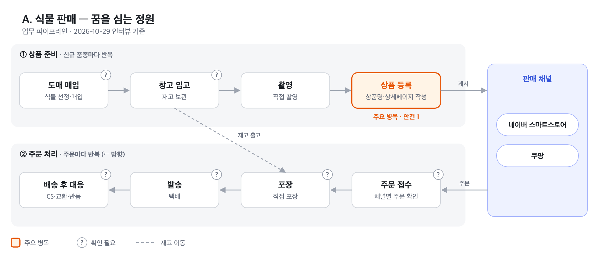

# 00. 개요

> 2026-10-29 클라이언트 인터뷰 기준. 미확인 내용은 '(확인 필요)'로 표기함.

## 클라이언트

- **클라이언트** — 강규렬. 온라인 커머스 운영 (식물 판매, 해외구매대행)
- **컨설턴트** — 안재형 (AI Agent 개발자). 무료 AX 컨설팅
- **진행 단계** — 현황 파악 및 문제 정의 (구현 전)

## 사업 현황

### A. 식물 판매 — 꿈을 심는 정원 (재고형)

실내용 식물을 국내 도매로 매입하여 자체 창고에 보관하고, 직접 포장·발송함.
판매 채널은 네이버 스마트스토어(기존)와 쿠팡(신규). 다품종 특성상 **신규 상품 등록의 속도와 규모**가 경쟁력임.

업무는 반복 단위가 다른 두 흐름으로 구성됨: ① 상품 준비(신규 품종 단위), ② 주문 처리(주문 단위).



<sub>원본: [assets/01-식물-파이프라인.html](assets/01-식물-파이프라인.html) — 수정 후 PNG 재생성 필요</sub>

| 흐름 | 단계 | 업무 내용 | 도구 | 비고 |
|---|---|---|---|---|
| ① | 도매 매입 | 판매 품종 선정 및 매입 | | 매입처·주기 (확인 필요) |
| ① | 창고 입고 | 재고 보관 | 자체 창고 | 재고 관리 방식 (확인 필요) |
| ① | 촬영 | 상품 사진 직접 촬영 | | |
| ① | **상품 등록** | 채널별 상품명·상세설명 등 작성 | 네이버, 쿠팡 | **주요 병목.** [안건 1](../01-식물-상품등록/00-개요.md) |
| ② | 주문 접수 | 채널별 주문 확인 | 네이버, 쿠팡 | 통합 관리 여부 (확인 필요) |
| ② | 포장·발송 | 직접 포장 및 택배 발송 | | 택배사·포장 방식 (확인 필요) |
| ② | 배송 후 대응 | CS, 교환·반품 | | 고사·파손 처리 방식 (확인 필요) |

### B. 해외구매대행 (무재고형)

타오바오 상품을 스마트스토어 25개에 등록하고, 주문 발생 시 매입하는 방식.
네이버의 스토어당 상품 수 제한과 사업자당 스토어 3개 제한으로 인해 **사업자 10개**를 보유함 (최대 30개 스토어 운영 가능).

```
[등록] 상품 선별 → 부스터로더로 업로드
[주문] shopmine 주문 수집 → 타오바오 주문 → 중국 배송대행지 입고 (업체명 확인 필요)
       → 입고 사진 검수 → 포장 옵션 선택·결제 → 재포장 후 국내 발송
       → CJ 송장번호 수령 → 스마트스토어 송장 입력
```

### 사용 도구

| 도구 | 용도 | 비고 |
|---|---|---|
| 네이버 스마트스토어 | 식물 판매, 구매대행 스토어 25개 | |
| 쿠팡 (쿠팡윙스) | 식물 판매 | |
| shopmine | 다중 스토어 통합 주문 관리 | 기능 범위 (확인 필요) |
| 부스터로더 | 구매대행 상품 선별·업로드 | 수강 강의에서 제공. 현재 구글 스프레드시트 기반, 2.0은 별도 소프트웨어로 출시 예정 |
| 중국 배송대행지 | 입고·검수 사진·재포장·국제 배송 | |

## 안건

| # | 안건 | 상태 | 문서 |
|---|---|---|---|
| 1 | 식물 상품 등록 자동화 | 요구사항 명확 | [01-식물-상품등록](../01-식물-상품등록/00-개요.md) |
| 2 | 해외구매대행 개선 | 병목 미확인. 부스터로더 2.0 출시 후 관찰 | [02-해외구매대행](../02-해외구매대행/00-개요.md) |
| 3 | 사업자 관리 | 문제 미정의. 추가 인터뷰 필요 | [03-사업자관리](../03-사업자관리/00-개요.md) |

## 공통 확인 사항

- [ ] 업무 시간 배분 (일·주 단위로 가장 많은 시간이 소요되는 업무)
- [ ] 두 사업의 매출 비중 및 향후 집중 방향
- [ ] 운영 인원 (단독 운영 여부)
- [ ] 월 주문 건수 (식물 / 구매대행)
