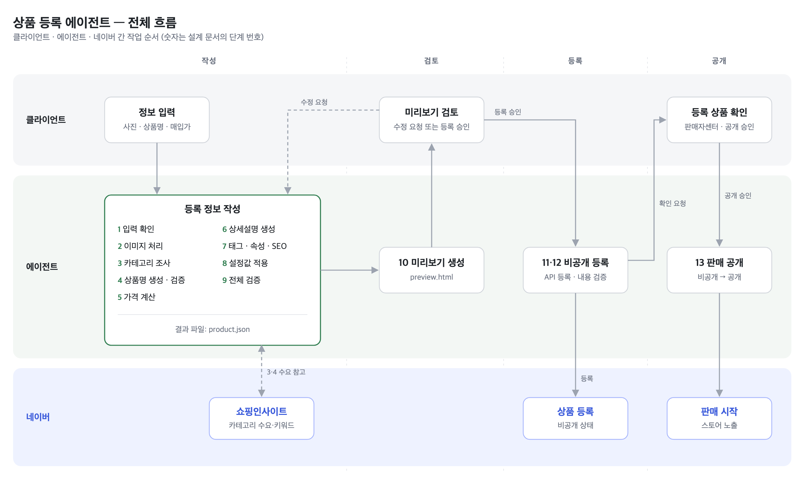

# 03. 설계 — 상품 등록 에이전트

> 2026-10-29 작성. 논의를 거쳐 확정된 사항과 미결정 사항을 구분하여 기록함.

## 용어

| 문서 용어 | 네이버 공식 용어 | 의미 |
|---|---|---|
| 비공개 등록 | 전시중지 (`SUSPENSION`) | 상품은 등록되었으나 고객에게 보이지 않는 상태 |
| 판매 공개 | 전시중 (`ON`) | 고객에게 노출되어 구매 가능한 상태 |
| 미리보기 | — | 등록 전 클라이언트가 결과를 검토하는 로컬 HTML 페이지 |
| 사진함 | — | 클라이언트가 새 상품 사진을 넣는 작업공간 내 폴더 |

## 1. 결정 사항

| 항목 | 결정 | 근거 |
|---|---|---|
| 운영자 | 클라이언트 (비개발자) | |
| 형태 | 코딩 에이전트 작업공간 (지침 + 절차 + 스크립트 + 폴더 구조) | 별도 서비스 개발 대비 구축·유지보수 비용이 낮고, 자연어로 수정 지시 가능 |
| 실행 환경 | 클라이언트 자택 **Windows PC**, **Codex 앱** | 채팅 UI만으로 사용 가능. 클라이언트가 ChatGPT 계정 보유. 같은 작업공간이 Claude 데스크톱 앱에서도 동작 |
| 사진 전달 | 채팅 첨부, 또는 `사진함` 폴더 | 첨부 파일 경로를 에이전트가 알 수 없으면 사진함 방식 사용 (리허설에서 확인) |
| 사전 확인 | 미리보기 (로컬 HTML) | 등록 전 사람이 결과 확인·수정 |
| 등록 방식 | 네이버 커머스API | 전 항목(태그·SEO 포함) 입력 가능, 이미지 업로드 API로 호스팅 문제 해소, 비공개 상태로 먼저 등록하여 판매 전 확인 가능 |
| API 설정 전 | 미리보기의 복사 버튼 + 상세 이미지로 직접 등록 | 커머스API 준비 전에도 바로 사용 가능 |
| 대체 경로 | 엑셀 일괄등록 | API 장애 시 동일 데이터로 엑셀 생성 (미구현) |

## 2. 전체 흐름



<sub>원본: [assets/03-전체흐름.html](assets/03-전체흐름.html) — 수정 후 PNG 재생성 필요</sub>

| # | 단계 | 내용 |
|---|---|---|
| 1 | 입력 확인 | 상품 폴더 생성, 사진·상품명·매입가·규격 확인 |
| 2 | 이미지 처리 | 대표이미지·추가이미지 순서 선택, 규격 변환 |
| 3 | 카테고리 조사 | 네이버 쇼핑 검색 API로 상위 상품 카테고리 집계 |
| 4 | 상품명 생성·검증 | 생성 후 상품명 규칙 자동 검사 |
| 5 | 가격 계산 | 설정값의 가격 규칙 적용 |
| 6 | 상세설명 생성 | HTML 작성 후 780px 상세 이미지 변환 |
| 7 | 태그·속성·SEO | 태그, 상품속성, Page Title, Meta description |
| 8 | 설정값 적용 | 배송·반품·A/S·상품정보제공고시 템플릿 등 |
| 9 | 전체 검증 | 필수값, 글자수, 금지문자, 옵션가 범위 |
| 10 | 미리보기 생성 | 클라이언트 검토용 preview.html. 수정 요청 시 해당 단계 재실행 |
| 11 | 비공개 등록 | 클라이언트 승인 후 API로 비공개 상태 등록 |
| 12 | 등록 내용 검증 | 등록된 상품을 다시 조회하여 product.json과 일치 여부 확인 |
| 13 | 판매 공개 | 클라이언트가 판매자센터에서 등록 상품 확인 후 승인하면 공개 |

## 3. 역할 분담 원칙

| 구분 | 담당 | 대상 |
|---|---|---|
| 판단 | AI (LLM) | 이미지 선택, 카테고리 선택, 상품명·상세설명·태그 작성, 사진 내용 해석 |
| 규칙 준수 | 스크립트 | 상품명 금지 규칙, 글자수, 코드값 변환, 옵션가 범위, 가격 계산, 이미지 변환, API 요청 형식 |
| 결정 · 승인 | 클라이언트 | 원천 정보 입력, 미리보기 검토, 등록·공개 승인 |

LLM은 동일 입력에도 결과가 달라질 수 있으므로, 결과가 항상 같아야 하는 작업은 스크립트로 처리함.

## 4. 작업공간 구조

```
plant-agent/
├── AGENTS.md                     # 지침 (단일 기준). CLAUDE.md는 이 파일을 불러옴
├── .claude/skills/
│   ├── register-product/         # 1~10단계 절차
│   └── publish-naver/            # 11~13단계 절차
├── 사진함/                        # 클라이언트가 새 상품 사진을 넣는 곳
├── config/
│   ├── store.toml                # 스토어 설정값 (아래 6절)
│   ├── naming-rules.toml         # 상품명 규칙 목록
│   ├── secrets.env               # API 키 (공유 제외)
│   └── codes/                    # 카테고리 코드표 (API에서 내려받음)
├── scripts/
│   ├── new_product.py            # 상품 폴더 생성, 사진 복사·이동
│   ├── prepare_images.py         # 대표·추가이미지 변환
│   ├── search_category.py        # 쇼핑 검색 API → 상위 상품 카테고리 집계
│   ├── price.py                  # 가격 계산
│   ├── export_detail.py          # 상세설명 → 780px 상세 이미지
│   ├── validate.py               # 상품 데이터 검증
│   ├── render_preview.py         # 상품 데이터 → 미리보기 HTML
│   └── naver_api.py              # 이미지 업로드, 상품 등록·조회·공개 전환
├── templates/                    # info.toml, product.json 양식
├── pyproject.toml                # 패키지 목록 (설치 시 uv sync 1회)
└── products/
    └── 2026-10-29_송오브인디아/
        ├── input/                # 사진, info.toml(상품 기본 정보)
        ├── images/               # 등록용 변환 이미지
        ├── product.json          # 등록 정보 (단일 기준 데이터)
        ├── detail.html           # 상세설명
        ├── detail_images/        # 판매자센터 업로드용 상세 이미지
        ├── preview.html          # 검토용 미리보기
        └── log.md                # 판단 근거, 수정 이력, 등록 결과
```

## 5. 상품 데이터 (product.json)

모든 출력(미리보기, API, 엑셀)은 이 파일 하나에서 생성됨. 항목마다 값과 함께 **근거**를 기록하여 미리보기에서 확인 가능하게 함.

```json
{
  "input": {
    "name": "무늬아이비",
    "composition": "1+1 (2개 구성)",
    "cost": 5000,
    "photos": ["추가사진1.jpeg", "추가사진2.jpeg", "추가사진3.jpeg"]
  },
  "category": {
    "code": "...",
    "path": "...",
    "basis": "네이버쇼핑 '무늬아이비' 검색 상위 10개(광고 제외) 중 7개가 해당 카테고리"
  },
  "name":   { "value": "...", "checks": [{ "rule": "동일 단어 반복", "result": "pass" }] },
  "price":  { "list": 13700, "discount_rate": 0.2, "sale": 10960, "basis": "가격 규칙 (6절)" },
  "images": { "representative": "...", "optional": ["..."] },
  "detail": { "format": "html", "content": "..." },
  "tags":   ["...", "..."],
  "attributes": {},
  "seo":    { "page_title": "...", "meta_description": "..." },
  "templates": { "delivery": "...", "notice": "...", "as": "..." },
  "status": { "stage": "draft | approved | private | public", "naver_product_no": null }
}
```

## 6. 스토어 설정값 (store.toml)

1회 구축 후 모든 상품에 공통 적용되는 값.

| 구분         | 항목                                            | 비고                                |
| ------------ | ----------------------------------------------- | ----------------------------------- |
| 가격 | 가격 규칙 (매입가 → 정가) | 확정 전 임시 규칙: 매입가 × 2.74 (7절 사례 비율). 정가 입력 시 그 값 우선 |
| 가격         | 기본할인율                                      | 20%                                 |
| 템플릿       | 배송비 / 상품정보제공고시 / A/S 템플릿          | 판매자센터 템플릿 생성 후 코드 기입 |
| 상품주요정보 | 원산지, 상품상태, 미성년자 구매, 브랜드·제조사 | 사실에 맞는 값으로 1회 확정         |
| 부가세       | 과세 / 면세                                     | 세무 확인 필요                      |
| API          | 애플리케이션 ID·시크릿                         | 파일 분리 보관, 외부 공유 금지      |

## 7. 기준 사례 — 무늬아이비 1+1

클라이언트가 실제 등록한 상품. 설계 검증 및 결과 비교의 기준으로 사용.

**입력 사진** ([data/01-식물-상품등록/상품사진/무늬아이비_1+1](../../data/01-식물-상품등록/상품사진/무늬아이비_1+1/))

| 파일           | 규격                   | 내용                                                                                                                      |
| -------------- | ---------------------- | ------------------------------------------------------------------------------------------------------------------------- |
| 썸네일.png     | 1254×1254, PNG, 1.7MB | **AI로 생성한 대표이미지.** 추가사진1을 바탕으로 배경을 흰색으로 정리하고 보정함. 구도·화분·잎 형태는 원본과 동일 |
| 추가사진1.jpeg | 780×780, JPEG         | 원본. 포트 2개 정면, 작업대 위 촬영                                                                                       |
| 추가사진2.jpeg | 780×780, JPEG         | 원본. 줄기·잎 무늬 근접                                                                                                  |
| 추가사진3.jpeg | 780×780, JPEG         | 원본. 잎 무늬 근접                                                                                                        |

전 사진 1:1 정사각형, 공식 권장 규격(640×640) 이상.

**가격 구조**

| 항목                 | 금액                   | 비고                           |
| -------------------- | ---------------------- | ------------------------------ |
| 매입가               | 2,500원 × 2 = 5,000원 | 1+1 구성                       |
| 정가 (판매가 입력값) | 13,700원               |                                |
| 기본할인             | 20%                    |                                |
| 실판매가             | 10,960원               | 13,700 × 0.8                  |
| 실판매가 / 매입가    | 약 2.19배              | 수수료·배송비·포장비 차감 전 |

**설계 반영 사항**

- 대표이미지 생성이 기존 업무에 포함되어 있음 → 2단계(이미지 처리)에 **AI 대표이미지 생성**을 정식 단계로 포함. Claude는 이미지 생성 기능이 없으므로 외부 이미지 생성 모델 연동 또는 현재 사용 도구 유지 중 선택 필요.
- 정가 13,700원·실판매가 10,960원의 산출 규칙을 확인하여 가격 계산을 스크립트화.
- '1+1'의 상품명 표기 가능 여부 확인 필요 (네이버 상품명 규정상 혜택 문구 해당 여부).

## 8. 미결정 사항

| # | 항목                 | 선택지                                                | 필요 정보                                                                    |
| - | -------------------- | ----------------------------------------------------- | ---------------------------------------------------------------------------- |
| 1 | 대표이미지 생성 도구 | (a) 외부 이미지 생성 API 연동 (b) 현재 사용 도구 유지 | 현재 ChatGPT 사용 → 당분간 (b). 자동화 시 OpenAI·Google 이미지 모델 비교   |
| 2 | 가격 규칙            | 배수 / 목표 마진 / 구간별 고정                        | 다른 상품 가격 사례 3~5건 (컨설턴트가 수집 예정). 확정 전까지 정가 직접 입력 |
| 3 | 상세설명 형식        | (a) HTML (텍스트 + 사진) (b) 상세 이미지              | (a) 우선 적용하여 구현. 클라이언트 현재 상세페이지와 비교 후 확정            |
| 4 | 쿠팡윙스 연동        | API / 엑셀 / 붙여넣기                                 | 보류                                                                         |

## 9. 리스크

| 리스크                        | 대응                                                                         |
| ----------------------------- | ---------------------------------------------------------------------------- |
| 자택 IP 변경 시 API 호출 차단 | 오류 발생 시 커머스API센터에서 IP 재등록. 에이전트가 해당 오류를 식별해 안내 |
| AI 결과 품질 편차             | 스크립트 검증, 미리보기 검토, 비공개 등록 후 판매자센터 확인의 3단계 검수    |
| 잘못된 정보 노출              | 비공개 상태로 등록하고 클라이언트 승인 후 공개                               |
| API 키 유출                   | 설정 파일 분리, 작업공간 공유 시 제외                                        |

## 10. 구현 현황

작업공간: [plant-agent/](../../plant-agent/) — 구성 요소별 상태는 [plant-agent/README.md](../../plant-agent/README.md) 참조.
무늬아이비 사례로 1~10단계(카테고리 조사 제외) 시범 실행 완료.

## 11. 다음 단계

1. 미결정 사항 1·2·3 클라이언트 확인
2. 커머스API 애플리케이션 신청 (클라이언트 계정)
3. 무늬아이비 사례로 2~10단계 시범 실행 → 실제 등록본과 비교 (0단계 검증)
