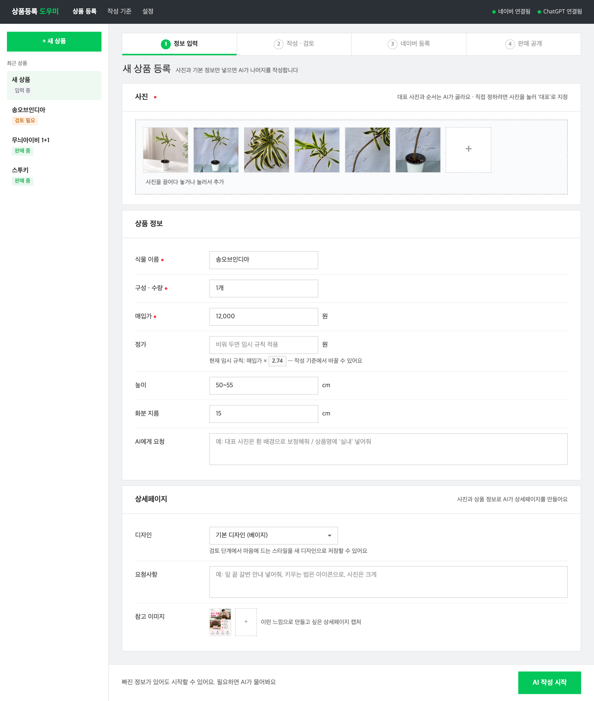
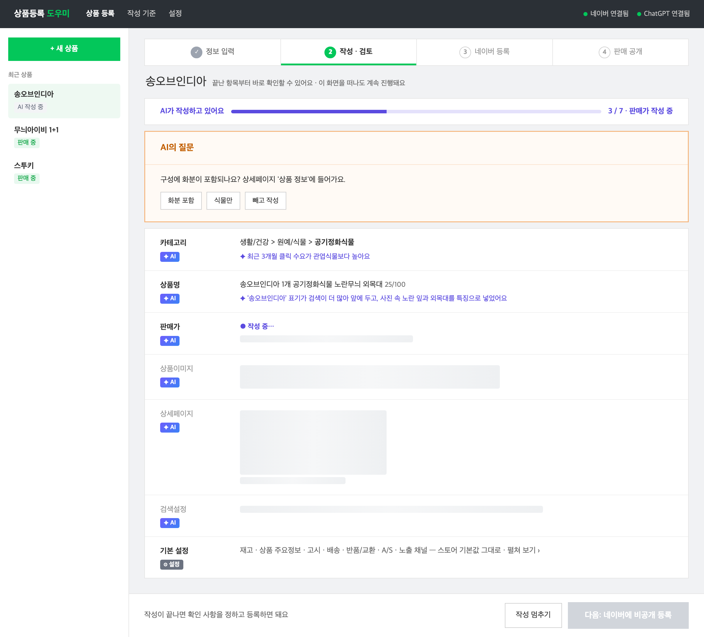
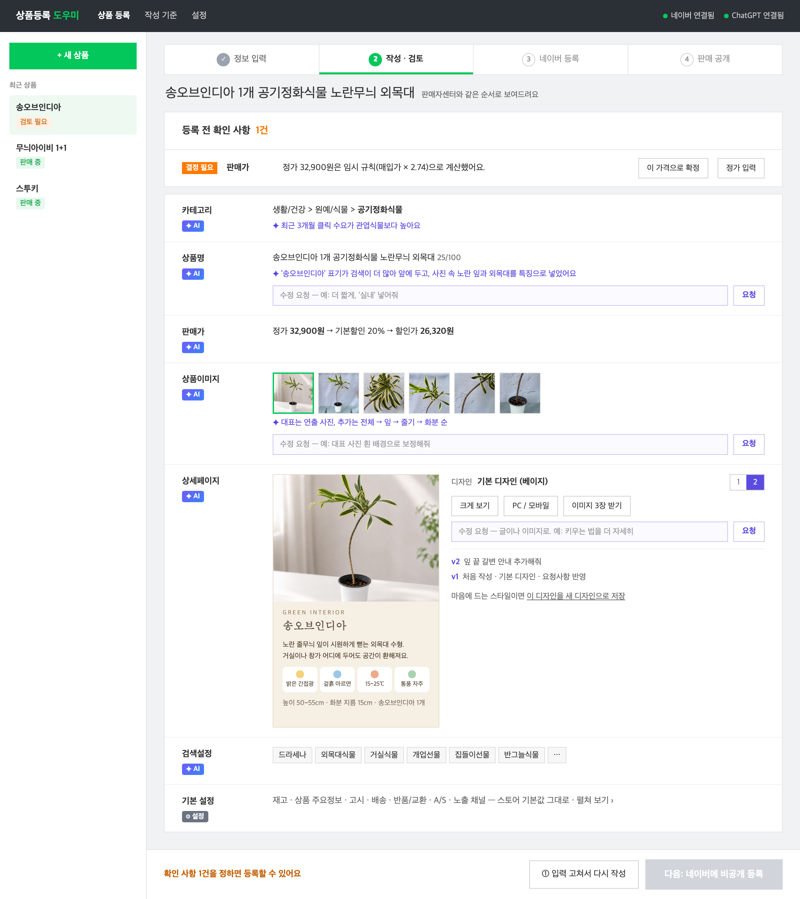
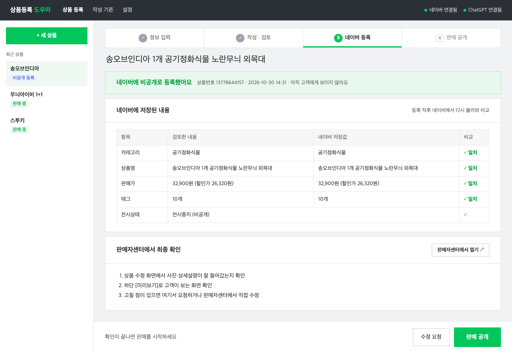
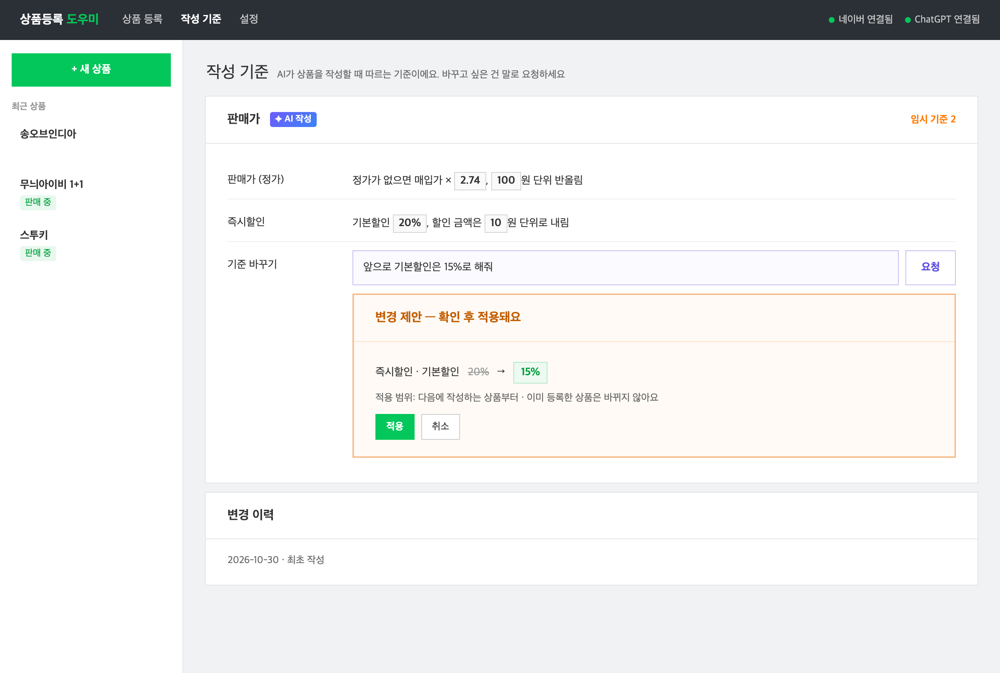

# 03. 웹서비스 — 개발 기획

Codex 앱 채팅 방식([07-사용-흐름](../02-Codex-PoC/04-사용-흐름.md))을 클라이언트 PC에서 실행되는 전용 웹서비스로 전환하기 위한 개발 기획.

## 1. 배경과 목표

- Codex 앱 방식으로 작성 → 검토 → 비공개 등록까지 시연 완료 (2026-10-30)
- 채팅 방식의 한계
  - 무엇을 입력하고 요청해야 하는지 사용자가 매번 판단해야 함
  - 등록·공개 같은 중요한 동작도 말로 요청함
  - 상품별 진행 상태를 한눈에 볼 수 없음
- 목표: 등록 전 과정을 **정해진 화면과 버튼**으로 진행하는 웹서비스. AI는 작성과 수정 판단만 담당

## 2. 결정 사항

| 항목 | 결정 | 이유 |
|---|---|---|
| 실행 형태 | 클라이언트 PC에서 실행되는 로컬 웹서비스 (브라우저로 접속) | ChatGPT 요금제로 AI 사용 가능. 네이버 커머스API의 IP 제한을 PC IP로 충족 |
| 호스팅 서비스 (Vercel 등) | 사용하지 않음 | AI 실행 시간 제한, 고정 IP 없음, ChatGPT 요금제 사용 불가 (API 비용 발생) |
| 화면 구성 | 단계형 4단계. 채팅창 없음. 섹션별 수정 요청 칸 | 진행 위치가 명확해 사용자가 안심함. 대화형 UI 개발 부담 회피 |
| 상세페이지 | 정보 입력 단계에 요청사항 포함. 별도 메뉴 없음. 요청할 때마다 버전으로 저장 | 상품 등록과 한 흐름으로 처리 |
| AI 엔진 | Codex app-server (ChatGPT 데스크톱 앱에 포함된 Codex) | 기존 작업공간(AGENTS.md, 작성기준.md, 스크립트)을 그대로 사용. 에이전트 루프·파일·실행 기능 내장. LangGraph 불필요 |
| AI 비용 | 클라이언트의 ChatGPT 요금제 사용량 | API 키 불필요 |
| 등록·공개 | 화면 버튼이 기존 스크립트를 직접 실행. AI는 실행하지 않음 | 잘못된 등록·중복 등록 방지 |
| 모바일 | 1차 범위 제외 | 사용 빈도 낮음. 추후 Tailscale(유료 플랜) 또는 Cloudflare Tunnel로 접속 |
| Codex 앱 방식 | 계속 사용 가능 상태로 유지 | 같은 작업공간을 공유하므로 웹서비스 장애 시 대체 수단 |

## 3. 기술 검증 결과 (2026-11-24)

컨설턴트 Mac에서 ChatGPT 앱 내장 Codex(`codex-cli 0.171.0-alpha.13`)의 app-server로 시험함.

| 시험 | 결과 | 비고 |
|---|---|---|
| ChatGPT 로그인으로 app-server 실행 | 성공 | 계정·요금제·사용 한도 조회 가능. 앱에서 로그인 시작 기능(`account/login/start`) 제공 |
| 사진 + 작성기준으로 상품명 작성 | 성공 (16초) | 사진은 파일 경로로 전달(`localImage`). 작성기준.md를 직접 읽고 작성 |
| 대표이미지 배경 보정 | 성공 (58초) | 내장 이미지 생성으로 배경만 흰색으로 변경. 식물·화분 형태 유지 |
| AI 질문 도구 (`request_user_input`) | 일반 모드에서 사용 불가 | 자체 방식으로 대체 (6장) |
| 모델·추론 수준 | 대화·요청 단위로 지정 가능 | 현재 기본값 gpt-6.1-sol / medium. 설정 화면에서 변경 |

발견한 문제: 작성기준.md의 변경 요청 예시("상품명에 '실내'를 꼭 넣어줘")를 AI가 기준으로 해석함. 개발 전 수정 필요 (8장 0단계).

## 4. 화면 구성

시안: [assets/화면시안-단계형.html](assets/화면시안-단계형.html)

```
① 정보 입력 ── ② 작성 · 검토 ── ③ 네이버 등록 ── ④ 판매 공개
```

| 화면 | 주요 내용 | 시안 |
|---|---|---|
| ① 정보 입력 | 사진 끌어넣기, 식물 이름·구성·매입가(필수), 정가·높이·화분 지름(선택), AI 요청사항, 상세페이지(디자인 선택·요청사항·참고 이미지) |  |
| ②-1 작성 중 | 진행 표시, AI 질문(버튼 응답), 완료된 섹션부터 미리보기에 표시 |  |
| ②-2 검토 | 등록 전 확인 사항, 섹션별 값·AI 판단 근거·수정 요청, 상세페이지 버전·요청 기록, 기본 설정 접기 |  |
| ③ 네이버 등록 | 비공개 등록 결과, 네이버 저장값 비교, 판매자센터 바로가기 |  |
| ④ 판매 공개 | 공개 전환 후 '판매 중' | (③ 화면의 버튼) |
| 작성 기준 | 기존 작성 기준 페이지 + 섹션별 '기준 바꾸기' → 변경 제안 확인 → 적용 |  |
| 설정 | 연결 상태(ChatGPT·네이버), 모델·추론 수준, 스토어 기본 설정 보기 | 미작성 |

공통: 왼쪽 상품 목록(상태 배지: AI 작성 중 / 검토 필요 / 비공개 등록 / 판매 중), 지난 단계로 이동 가능, 다음 단계 버튼은 하단 한 곳.

비교용 한 화면 시안: [assets/화면시안-한화면.html](assets/화면시안-한화면.html)

## 5. 시스템 구조

```
브라우저 (클라이언트 PC)
   │  HTTP · SSE(진행 상황 실시간 전달)
   ▼
웹 서버 (Python, plant-agent 안에서 실행)
   ├─ Codex app-server ── stdio JSON-RPC ── AI 작성·수정 (ChatGPT 요금제)
   ├─ 기존 스크립트 ── price / prepare_images / validate / render_preview / export_detail / naver_api
   └─ products/<상품>/ ── product.json (단일 기준 데이터), 사진, 상세 HTML·이미지, 기록
```

- 작업공간 구조는 그대로 유지. 웹 서버는 plant-agent 폴더에 추가하는 구성 요소
- product.json이 유일한 기준 데이터라는 원칙 유지. 화면은 product.json을 읽어 표시
- AI가 파일을 바꾸면 서버가 변경을 감지해 화면에 반영

### 추가 데이터

| 파일 | 내용 |
|---|---|
| `product.json`의 `status` | 단계(입력 / 작성 중 / 검토 / 비공개 등록 / 판매 중), 섹션별 작성 상태 |
| `detail/v1.html`, `v2.html` … | 상세페이지 버전. 요청 내용과 함께 기록 |
| `requests.json` | 섹션별 수정 요청 이력 |
| `question.json` | AI 질문 (6장). 답하면 삭제 |
| `config/app.toml` | 모델·추론 수준 등 웹서비스 설정 |

## 6. AI 작업 설계

웹서비스의 AI 작업은 모두 Codex app-server의 대화(thread)와 요청(turn)으로 처리함. 상품마다 대화 1개를 유지하고, 수정 요청은 같은 대화에 이어서 보냄.

| 작업 | 시작 | AI 범위 | 완료 후 서버 처리 |
|---|---|---|---|
| 전체 작성 | [AI 작성 시작] | 이미지 선택, 카테고리, 상품명, 상세페이지, 태그 등 product.json 작성 | price → validate → render_preview |
| 섹션 수정 | 섹션의 [요청] | 해당 섹션만 수정 | validate → render_preview |
| 상세페이지 수정 | 상세페이지 [요청] | 새 버전 작성 | export_detail, 버전 기록 |
| 대표이미지 보정 | 상품이미지 [요청] | 이미지 생성, 원본 보존 | prepare_images (원본 대조 기록) |
| 기준 변경 제안 | 작성 기준 [요청] | 변경안만 작성 (파일 수정 안 함) | 사용자가 [적용]하면 서버가 반영, 변경 이력 기록 |

- **진행 표시**: AI가 섹션을 끝낼 때마다 product.json에 저장하도록 지침에 명시 → 서버가 파일 변경을 감지해 SSE로 전달 → 해당 섹션이 채워짐
- **AI 질문**: AI가 정보가 부족하면 `question.json`에 질문과 선택지를 쓰고 요청을 마침 → 화면에 버튼으로 표시 → 답을 다음 요청으로 전달
- **모델·추론 수준**: 작업 종류별로 `config/app.toml`에서 지정 (예: 전체 작성 medium, 섹션 수정 low)
- **실행 권한**: 작업 폴더는 plant-agent로 한정, 파일 쓰기 허용, 승인 요청 없음. 네이버 등록·공개 스크립트는 AI가 실행하지 않도록 지침에 명시하고, 서버에서도 해당 명령 실행 여부를 감시
- **웹서비스용 지침**: 기존 SKILL(채팅용)과 별도로 웹서비스 요청 형식에 맞춘 지침 추가. 작성 기준은 작성기준.md를 공유

## 7. 기술 스택

| 영역 | 선택 | 이유 |
|---|---|---|
| 서버 | Python 3.11 + FastAPI + uvicorn | 기존 스크립트와 같은 언어. uv로 설치 관리 |
| 화면 | 서버에서 만든 HTML + 소량 JavaScript (빌드 도구 없음) | 설치 단순. 미리보기·작성 기준 페이지와 같은 방식 |
| 실시간 전달 | SSE (Server-Sent Events) | 진행 상황을 서버 → 화면 한 방향으로 보내면 충분 |
| AI 연결 | Codex app-server, stdio JSON-RPC | 3장 검증 완료 |
| 실행 | 바로가기 실행 시 서버 시작 + 브라우저 열기. PC 시작 시 자동 실행 옵션 | 사용자 조작 최소화 |

## 8. 개발 단계

| 단계 | 내용 | 산출물 | 예상 기간 |
|---|---|---|---|
| 0. 사전 정리 | 작성기준.md 예시 문단 표기 수정. 웹서비스용 지침 초안. product.json 단계·상태 필드 정의 | 수정된 지침·기준 | 0.5일 |
| 1. 뼈대 | 서버, 상품 목록, ① 정보 입력, 전체 작성 요청, ② 검토(기존 미리보기), ③ 등록·④ 공개 버튼 | 처음부터 끝까지 동작하는 최소 버전 | 2~3일 |
| 2. 다듬기 | 섹션별 진행 표시, AI 질문, 섹션 수정 요청, 상세페이지 버전, 대표이미지 보정, 작성 기준 변경 | 시안 수준의 화면 | 2~3일 |
| 3. 설정·설치 | 설정 화면(연결 상태, 모델, 로그인), Windows 설치·자동 실행, 오류 안내(IP 차단 등) | 설치 안내, 리허설 결과 | 1~2일 |

- 1단계 완료 시점부터 클라이언트가 실제로 사용 가능
- 예상 기간은 개발 집중 기준이며 3장 외 추가 기술 문제가 없다는 전제

## 9. 위험과 대응

| 위험 | 대응 |
|---|---|
| app-server는 실험 기능으로 표시됨. ChatGPT 앱 업데이트 시 동작 변경 가능 | 시작 시 버전과 기본 동작 점검. 문제 시 Codex 앱 방식으로 작업 지속 |
| 클라이언트 요금제 사용 한도 | 설정 화면에 남은 사용량 표시. 가벼운 작업은 낮은 추론 수준 사용 |
| 네이버 IP 변경으로 등록 차단 | 오류 시 쉬운 안내와 재등록 방법 표시 |
| AI 결과 편차 | 작성기준.md와 검증 스크립트로 통제. 섹션별 수정으로 부분 보완 |
| 작업 중 PC 종료·브라우저 닫힘 | 상태를 파일에 저장해 다시 열면 이어서 진행 |
| 동시에 여러 상품 작성 | 1차는 한 번에 하나만 작성하도록 제한 |

## 10. 확인 필요

- [ ] 클라이언트 ChatGPT 요금제 (Plus / Pro)와 사용 한도
- [ ] Windows용 ChatGPT 앱에 포함된 Codex 실행 파일 위치와 app-server 동작
- [ ] 클라이언트 PC 사양, 상시 켜두는지 여부
- [ ] 상세페이지 기본 디자인 (초기 설정 시 클라이언트 기존 상세페이지를 참고해 함께 제작)
- [ ] 판매자센터 상품 수정 화면으로 바로 가는 주소 형식
