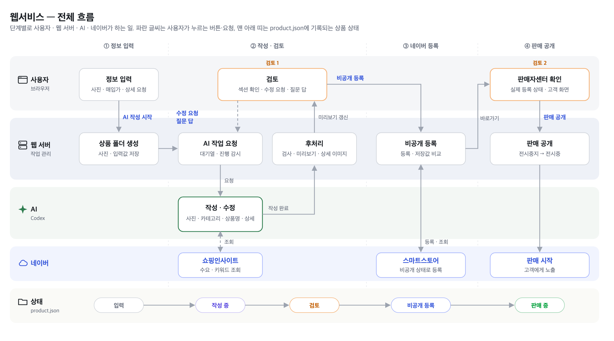
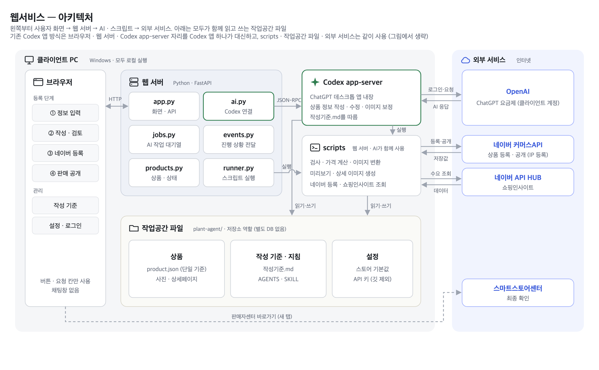

# 01. 설계

[00-개요](00-개요.md)의 결정 사항을 구현 단위로 구체화한 설계. 대상 독자는 개발자(컨설턴트).

### 전체 흐름



<sub>원본: [assets/01-전체흐름.html](assets/01-전체흐름.html) — 수정 후 PNG 재생성 필요</sub>

### 아키텍처



<sub>원본: [assets/01-아키텍처.html](assets/01-아키텍처.html) — 수정 후 PNG 재생성 필요</sub>

## 1. 설계 원칙

1. **product.json이 유일한 기준 데이터.** 화면, 네이버 등록, Codex 앱 방식 모두 product.json을 읽고 씀. 웹서비스 전용 상태도 product.json(`status`)에 둠
2. **기존 스크립트를 그대로 사용.** price, prepare_images, validate, render_preview, export_detail, naver_api는 웹 서버가 하위 프로세스로 실행. Codex 앱 방식과 같은 스크립트를 공유
3. **AI는 작성만, 실행은 서버가.** 등록·공개는 서버가 스크립트를 직접 실행. AI의 네이버 스크립트 실행은 금지·감시
4. **AI 연결은 한 모듈로.** Codex app-server 호출은 `ai.py` 한 곳에서만. 엔진 교체 시 이 모듈만 변경
5. **한 번에 하나의 AI 작업.** 작업 대기열로 순서 보장. 사용 한도와 파일 충돌 방지
6. **상태는 파일에 저장.** 서버·브라우저를 다시 켜도 이어서 진행

## 2. 폴더 구조

웹서비스는 plant-agent 안에 `web/` 폴더로 추가함. 기존 폴더는 변경 없음.

```
plant-agent/
├─ AGENTS.md, 작성기준.md, config/, scripts/, templates/, products/   (기존)
├─ config/app.toml          웹서비스 설정 (신규)
├─ web/
│  ├─ __main__.py           실행 진입점: 서버 시작 + 브라우저 열기
│  ├─ app.py                FastAPI 앱, 화면·API 라우트
│  ├─ ai.py                 Codex app-server 연결 (JSON-RPC 클라이언트)
│  ├─ jobs.py               AI 작업 대기열, 작업 종류별 처리
│  ├─ products.py           상품 폴더·product.json·상태 읽기/쓰기
│  ├─ runner.py             기존 스크립트 실행 (uv run scripts/...)
│  ├─ events.py             SSE 발행, product.json 변경 감시
│  ├─ prompts/              AI 요청 문장 템플릿 (작업 종류별 .md)
│  ├─ templates/            화면 HTML (Jinja2)
│  └─ static/               CSS, JavaScript
├─ start.bat / start.command 바로가기용 실행 파일
└─ logs/                    서버 로그 (깃 제외)
```

추가 의존성: `fastapi`, `uvicorn`, `jinja2`, `python-multipart`(사진 업로드). `pyproject.toml`에 추가 후 `uv sync`.

## 3. 데이터 설계

**작업공간 파일이 저장소(DB) 역할을 함.** 별도 데이터베이스 없이 폴더와 JSON·TOML 파일에 모든 상태를 저장함.

| DB 개념 | 작업공간 파일 |
|---|---|
| 상품 테이블의 한 행 | `products/<상품>/product.json` |
| 상태 컬럼 | product.json의 `status` |
| 첨부 파일 | 같은 폴더의 사진, 상세페이지 버전 |
| 이력 | `requests.json`, `detail/versions.json`, `log.md` |
| 설정 | `config/` |
| 목록 조회 | `products/` 폴더를 읽어 상태별 정리 |

- 파일을 쓰는 이유: AI(Codex)가 별도 도구 없이 직접 읽고 씀. Codex 앱 방식과 데이터를 그대로 공유. 사람이 열어 보고 고칠 수 있음. 규모(사용자 1명, 작업 1개씩, 상품 수백 개)에 충분함
- 동시 쓰기 방지: AI 작업은 한 번에 하나. AI 작업 중 서버는 해당 상품의 `status`만 수정
- 저장 중 손상 방지: 서버는 임시 파일에 쓴 뒤 교체하는 방식(atomic write)으로 저장
- 잘못된 값 방지: validate 검사, 섹션 수정 작업은 전후 비교 (11장)
- 확장: 상품 수천 개 또는 여러 사용자 단계에서 목록·검색용 SQLite를 추가하고 파일은 기준 데이터로 유지

### 3.1 상품 폴더

```
products/<YYYY-MM-DD_식물이름>/
├─ input/            사진 원본, info.toml                    (기존)
├─ images/           등록용 이미지                            (기존)
├─ product.json      등록 정보 + 상태                         (기존, status 확장)
├─ detail.html       현재 상세페이지                           (기존)
├─ detail_images/    현재 상세 이미지                          (기존)
├─ detail/           상세페이지 버전 (신규)
│  ├─ v1.html, v2.html …
│  └─ versions.json  [{v, request, created_at}]
├─ requests.json     섹션별 수정 요청 이력 (신규)
├─ question.json     AI 질문 — 답하면 삭제 (신규)
├─ preview.html      미리보기                                 (기존)
└─ log.md            작업 기록                                 (기존)
```

- `detail.html`은 항상 현재 선택된 버전의 사본. 기존 스크립트(export_detail, naver_api)는 수정 없이 동작
- 상품 ID는 폴더 이름

### 3.2 product.json `status` 확장

```json
"status": {
  "stage": "review",
  "sections": {
    "images": "done", "category": "done", "name": "done", "price": "done",
    "detail": "writing", "tags": "pending"
  },
  "thread_id": "019a…",
  "job": {"type": "revise", "section": "detail", "started_at": "…"},
  "error": null,
  "approval_note": "…"
}
```

| stage | 의미 | 화면 단계 | 목록 배지 |
|---|---|---|---|
| `input` | 정보 입력 중 | ① | 입력 중 |
| `writing` | AI 전체 작성 중 | ②-1 | AI 작성 중 |
| `review` | 검토 중 (수정 요청 포함) | ②-2 | 검토 필요 |
| `private` | 비공개 등록됨 | ③ | 비공개 등록 |
| `public` | 판매 중 | ④ | 판매 중 |

- 기존 값 `draft`는 `input`/`review`로, `approved`는 등록 직전 내부 값으로 해석 (Codex 앱 방식 호환)
- `sections` 값: `pending` / `writing` / `done`. AI가 섹션을 끝낼 때마다 `done`으로 기록
- `thread_id`: 상품별 Codex 대화. 수정 요청은 같은 대화에 이어서 보냄

### 3.3 question.json

```json
{"id": "q1", "section": "input", "question": "구성에 화분이 포함되나요?",
 "options": ["화분 포함", "식물만"], "allow_text": true}
```

### 3.4 config/app.toml

```toml
[server]
port = 8765
open_browser = true

[ai]
codex_path = ""              # 비우면 자동 탐색 (ChatGPT 앱 내장 Codex)

[ai.jobs]                    # 작업 종류별 모델·추론 수준
write   = { model = "gpt-6.1-sol", effort = "medium" }
revise  = { model = "gpt-6.1-sol", effort = "low" }
detail  = { model = "gpt-6.1-sol", effort = "medium" }
image   = { model = "gpt-6.1-sol", effort = "medium" }
criteria = { model = "gpt-6.1-sol", effort = "medium" }
```

## 4. AI 연결 (`ai.py`)

Codex app-server를 서버 시작 시 1개 실행해 유지함. stdio로 JSON-RPC 메시지를 주고받음 (기술 검증 스크립트 기반).

| 기능 | 사용하는 메서드 |
|---|---|
| 초기화 | `initialize` → `initialized` |
| 로그인 상태·요금제·사용량 | `account/read`, `account/rateLimits/read` |
| 로그인 | `account/login/start` (브라우저로 ChatGPT 로그인) → `account/login/completed` 알림 |
| 대화 생성·재개 | `thread/start` (cwd=plant-agent, sandbox=workspace-write, approvalPolicy=never), `thread/resume` |
| 요청 | `turn/start` (텍스트 + `localImage`, model·effort 지정) |
| 중단 | `turn/interrupt` |
| 진행 알림 | `item/started`, `item/completed`, `item/agentMessage/delta`, `turn/completed`, `error` |
| 서버 측 요청 | 승인 요청은 정책상 발생하지 않음. 발생 시 거절하고 기록 |

- **Codex 실행 파일 탐색**: `config/app.toml` 지정값 → macOS `/Applications/ChatGPT.app/Contents/Resources/codex-cli/bin/codex` → Windows 설치 경로(확인 필요) → PATH의 `codex`
- **프로세스 관리**: 비정상 종료 시 자동 재시작, 진행 중이던 작업은 오류 처리
- **네이버 스크립트 실행 감시**: `commandExecution` 항목의 명령에 `naver_api`가 있으면 즉시 `turn/interrupt`, 작업 오류 처리

## 5. AI 작업 (`jobs.py`)

### 5.1 작업 종류

| 작업 | 시작 | AI 요청 내용 (prompts/) | 완료 후 서버 처리 |
|---|---|---|---|
| `write` 전체 작성 | ① [AI 작성 시작] | 사진 전체 + info.toml + 요청사항. register-product 절차 중 1~7단계 수행, 섹션 완료마다 product.json 저장 | price → validate → render_preview → export_detail. stage=`review` |
| `revise` 섹션 수정 | ② 섹션 [요청] | 해당 섹션만 수정, 다른 섹션 변경 금지 | validate → render_preview, requests.json 기록 |
| `detail` 상세 수정 | ② 상세페이지 [요청] | 새 버전 `detail/vN.html` 작성 (참고 이미지 포함 가능) | detail.html 갱신 → export_detail → validate → render_preview, versions.json 기록 |
| `image` 대표 보정 | ② 상품이미지 [요청] | 이미지 생성, `input/대표_*.png` 저장, 원본 보존 | prepare_images(--original, --edit) → validate → render_preview |
| `answer` 질문 답 | AI 질문 버튼 | 답을 전달하고 중단된 작업 계속 | 원래 작업의 완료 처리 |
| `criteria` 기준 변경 제안 | 작성 기준 [요청] | 변경안만 작성 (6장). 파일 직접 수정 금지 | 제안 화면 표시 |

- 대기열: 한 번에 1개 실행. 같은 상품에 작업이 있으면 요청 버튼 비활성
- 작업 상태는 `status.job`에 기록. 서버 재시작 시 남아 있으면 '중단됨'으로 표시하고 다시 시도 버튼 제공

### 5.2 요청 문장 구성

`web/prompts/<작업>.md` 템플릿에 값을 채워 보냄. 공통 머리말(웹 모드 규칙):

- 사용자와 대화하지 않음. 결과는 파일로만 남김 (최종 응답은 한 줄 요약)
- 작성 기준은 `작성기준.md`, 절차는 `.claude/skills/register-product/SKILL.md`를 따름
- 섹션을 끝낼 때마다 product.json의 해당 값과 `status.sections`를 저장
- 정보가 부족해 진행할 수 없으면 `question.json`을 쓰고 요청을 끝냄
- 브라우저를 열지 않음. `naver_api.py`를 실행하지 않음. validate·render_preview 실행은 서버가 하므로 생략 가능

### 5.3 AI 질문 처리

```
AI: question.json 작성 후 요청 종료
서버: turn/completed 감지 → question.json 확인 → status.job.waiting = true → SSE 'question'
화면: 질문 카드와 선택지 버튼 표시
사용자: 버튼 선택
서버: question.json 삭제 → 같은 대화에 "답: 식물만. 이어서 작성해줘" 요청 (answer 작업)
```

### 5.4 스크립트 실행 주체

판단이 필요한 스크립트는 AI가, 정해진 순서로 돌리면 되는 스크립트는 서버가 실행함.

| 스크립트 | 실행 | 이유 |
|---|---|---|
| shopping_insight, category_history | AI | 비교할 후보·비슷한 식물 판단 |
| prepare_images | AI | 대표·추가이미지 선택을 인자로 전달 |
| price, validate, render_preview, export_detail | 서버 | 매번 같은 순서로 확실하게 실행. AI 사용량 절약. 완료 시점을 서버가 알아야 화면 갱신 가능 |
| render_criteria | 서버 | 기준 변경 적용 후 |
| naver_api | 서버만 | 사용자 버튼으로만 실행. AI 실행은 감시·중단 (4장) |

Codex 앱 방식에서는 AI가 모두 실행함. 웹 모드 지침(5.2)에서 서버 담당 스크립트는 생략하도록 안내해 중복 실행을 막음.

## 6. 작성 기준 변경

1. 사용자가 작성 기준 페이지의 섹션에서 요청 입력
2. `criteria` 작업: AI가 `.proposals/<시각>.json`에 변경안 작성

```json
{"summary": "기본할인 20% → 15%", "scope": "다음 작성 상품부터",
 "changes": [{"file": "config/store.toml", "key": "price.discount_rate", "before": 0.2, "after": 0.15}],
 "history": "판매가 · 기본할인 20% → 15%"}
```

3. 화면에 변경 제안(전/후) 표시 → [적용] 시 서버가 반영
   - 허용 파일: `작성기준.md`, `config/store.toml`, `config/store.local.toml`, `config/naming-rules.toml`
   - 허용하지 않는 항목: 주소록 ID, API 키, `[네이버 규칙]` 표시 기준
   - 작성기준.md 변경은 섹션 단위 텍스트 교체. 적용 후 변경 이력 추가 → render_criteria 실행
4. [취소] 시 제안 파일 삭제

## 7. 화면과 API (`app.py`)

### 7.1 화면 (서버에서 HTML 생성)

| 경로 | 화면 |
|---|---|
| `/` | 최근 상품으로 이동, 없으면 새 상품 |
| `/products/new` | ① 정보 입력 |
| `/products/{id}` | stage에 맞는 단계 화면 (①~④) |
| `/criteria` | 작성 기준 (render_criteria 결과 + 요청 칸) |
| `/settings` | 연결 상태, 로그인, 모델 설정, 스토어 기본 설정 보기 |
| `/files/{id}/...` | 상품 폴더의 이미지·상세 HTML 제공 (읽기 전용) |

②-2 검토 화면은 `render_preview.py`의 섹션 생성 함수를 재사용함. `render_preview`에 웹 모드 옵션을 추가해 섹션마다 수정 요청 칸과 작성 상태(작성 중 표시)를 넣음.

### 7.2 API

| 메서드 · 경로 | 동작 |
|---|---|
| `POST /api/products` | 사진·입력값으로 상품 폴더 생성 (new_product 로직), stage=`input` |
| `PUT /api/products/{id}/input` | 입력값 저장 (info.toml) |
| `POST /api/products/{id}/write` | 전체 작성 작업 등록 |
| `POST /api/products/{id}/revise` | `{section, text, images?}` 섹션 수정 작업 |
| `POST /api/products/{id}/answer` | `{id, answer}` AI 질문 답 |
| `POST /api/products/{id}/detail/select` | `{v}` 상세페이지 버전 선택 |
| `POST /api/products/{id}/decide` | `{item, value}` 확인 사항 처리 (예: 임시 가격 확정, 정가 입력) |
| `POST /api/products/{id}/register` | 비공개 등록 → 재조회 대조. stage=`private` |
| `POST /api/products/{id}/publish` | 판매 공개. stage=`public` |
| `POST /api/jobs/{id}/stop` | 진행 중 작업 중단 |
| `GET /api/products/{id}/events` | SSE: 섹션 상태, 진행 메시지, 질문, 완료·오류 |
| `POST /api/criteria/propose` · `/apply` · `/cancel` | 기준 변경 |
| `GET /api/account` · `POST /api/account/login` | 로그인 상태·사용량, 로그인 시작 |

### 7.3 실시간 갱신 (`events.py`)

- AI 작업 중 1초 간격으로 product.json 수정 시각 확인 → 바뀐 `status.sections`를 SSE로 전송
- 화면은 이벤트를 받으면 해당 섹션 HTML만 다시 요청해 교체
- Codex 알림 중 사용자에게 의미 있는 것만 진행 메시지로 변환 (예: 이미지 생성 시작 → "대표 사진 보정 중")

## 8. 네이버 등록·공개 (`runner.py`)

| 동작 | 실행 | 비고 |
|---|---|---|
| 비공개 등록 | `naver_api.py register` → `verify` | 등록 전 validate 오류 0건·확인 사항 해결 확인 |
| 저장값 비교 | `naver_api.py verify --json` | **추가 필요**: 비교 결과를 JSON으로 출력하는 옵션 |
| 판매 공개 | `naver_api.py publish` | |
| 판매자센터 링크 | 상품번호로 상품 수정 화면 주소 생성 | 주소 형식 확인 필요 |

- 오류는 쉬운 문장으로 변환해 표시: IP 차단 → "인터넷 주소(IP)가 바뀌어…", 태그 거절 → 해당 태그를 등록 불가 목록에 추가할지 제안
- 같은 상품 중복 등록 방지: `naver.origin_product_no`가 있으면 등록 버튼 대신 '수정 반영'(2차 범위)

## 9. 기존 파일 변경 사항

| 파일 | 변경 |
|---|---|
| `작성기준.md` | 변경 요청 예시(`>`)를 기준과 구분되게 표기 (예: '변경 요청 예시 — 기준 아님') |
| `render_criteria.py` | 위 표기 변경 반영 |
| `render_preview.py` | 섹션 HTML 생성 함수 분리, 웹 모드(수정 요청 칸·작성 상태) 옵션 |
| `naver_api.py` | `verify --json` 출력 |
| `AGENTS.md`, `register-product/SKILL.md` | 섹션별 저장(`status.sections`) 규칙, `question.json` 질문 방식 (Codex 앱 방식에서도 무해) |
| `pyproject.toml` | fastapi, uvicorn, jinja2, python-multipart 추가 |
| `.gitignore` | `logs/`, `.proposals/` |

## 10. 실행과 설치

- 실행: `start.bat`(Windows) / `start.command`(macOS) → `uv run python -m web` → 서버 시작 후 브라우저 자동 열기 (`http://127.0.0.1:8765`)
- 서버는 `127.0.0.1`에만 연결 (외부 접속 차단). 모바일 지원 시 별도 검토
- 자동 실행: Windows 시작 프로그램 폴더에 바로가기 등록 (선택)
- 첫 실행 점검: Codex 실행 파일, ChatGPT 로그인, `config/secrets.env`, 네이버 토큰 발급 → 설정 화면에 결과 표시

## 11. 오류 처리

| 상황 | 처리 |
|---|---|
| ChatGPT 로그인 안 됨 / 사용 한도 초과 | 작업 시작 전 확인. 설정 화면으로 안내 |
| Codex app-server 종료 | 자동 재시작, 진행 작업은 '중단됨' + 다시 시도 |
| AI 작업 중 validate 오류 | 검토 화면 '수정 필요'로 표시 (현재 미리보기와 동일) |
| AI가 다른 섹션까지 변경 | 수정 작업 전후 product.json 비교, 대상 외 섹션 변경은 되돌리고 기록 |
| 네이버 API 오류 | 8장 문장 변환. 같은 요청 자동 재시도 안 함 |
| 브라우저 닫힘·PC 재시작 | 상태 파일 기준으로 복원 |

## 12. 검증 계획

- 단위 시험: products(상태 전환), jobs(대기열·질문 흐름), 기준 변경 적용(허용 파일·키 검사)
- AI 연결 시험: 가짜 app-server(정해진 응답을 내는 스크립트)로 ai.py·jobs.py 검사
- 통합 시험: 테스트 스토어로 ① → ④ 전 과정. 송오브인디아·무늬아이비 2건
- Windows 시험: 클라이언트 PC 또는 Windows 환경에서 설치·실행·한글 경로 확인

## 13. 구현 순서

[00-개요](00-개요.md) 8장 단계와 대응.

| 단계 | 구현 범위 |
|---|---|
| 0. 사전 정리 | 9장의 작성기준.md·render_criteria·AGENTS·SKILL 변경, `verify --json` |
| 1. 뼈대 | web/ 기본 구조, ai.py, products.py, runner.py, 화면 ①·②-2·③·④ (섹션 진행 표시 없이 완료 후 표시), 등록·공개 |
| 2. 다듬기 | events.py(섹션 진행), 질문 처리, revise·detail·image 작업, 상세 버전, 작성 기준 변경 |
| 3. 설정·설치 | 설정 화면·로그인, start 파일, Windows 경로 탐색, 오류 문장 정리, 리허설 |

## 14. 확인 필요

- [ ] Windows용 ChatGPT 앱의 Codex 실행 파일 경로
- [ ] 판매자센터 상품 수정 화면 주소 형식 (상품번호 기준)
- [ ] Codex app-server 승인 정책 `never` + `workspace-write`에서 이미지 생성 결과 저장 위치 (검증 시 `~/.codex/generated_images` 후 복사됨)
- [ ] 수정 요청 시 같은 대화를 이어 쓰는 방식과 새 대화 방식의 품질·속도 비교
