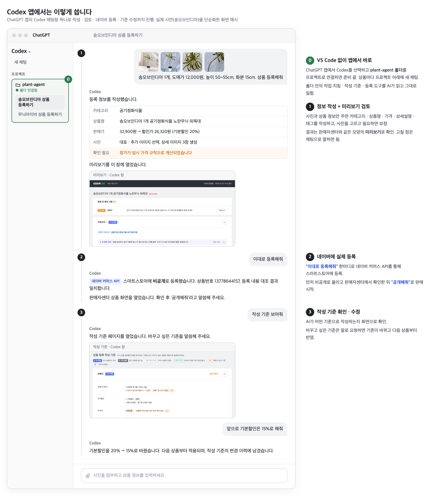
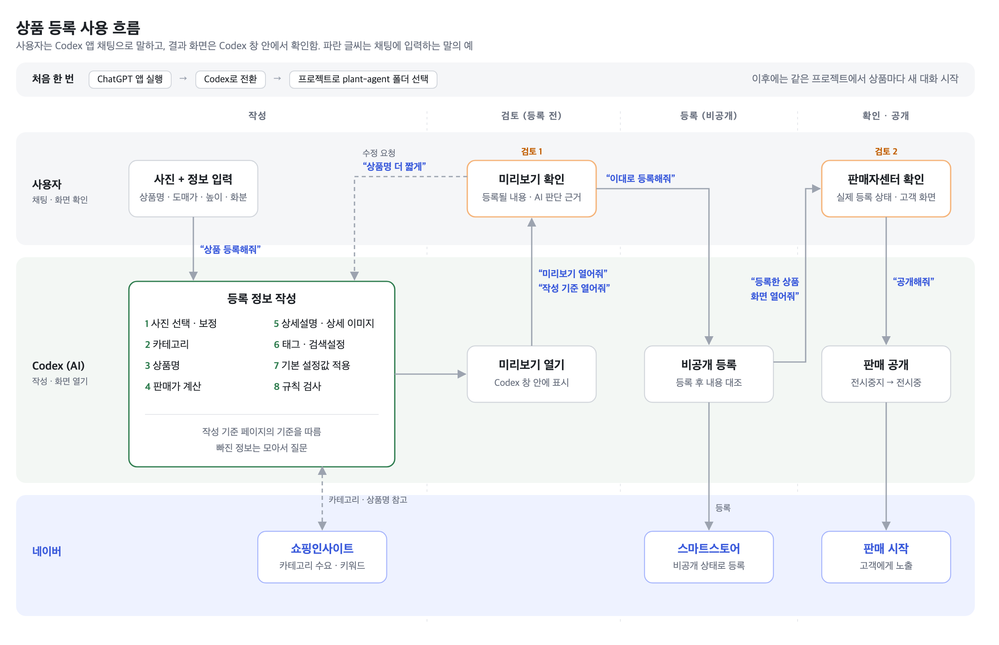

# 상품 등록 사용 흐름

Codex 앱 채팅으로 신규 상품을 네이버 스마트스토어에 등록하는 순서. 함께 전달한 시연 영상과 같은 흐름임.

## 한눈에 보기

- VS Code 없이 ChatGPT 앱에서 Codex로 전환하고 `plant-agent` 폴더를 연결하면 준비 완료
- 채팅창에 사진과 상품 정보를 넣고 요청하면
  1. 등록에 필요한 정보를 작성하고(사진 선택·보정 포함) 미리보기로 검토할 수 있게 보여줌
  2. 등록을 요청하면 네이버 커머스 API로 스마트스토어에 실제 등록
  3. AI의 작성 기준을 화면으로 보여주고, 말로 요구사항을 전하면 기준을 수정

## 전체 흐름

## 처음 한 번 — 준비

1. 바탕화면에서 ChatGPT 앱 실행
2. Codex로 전환
3. 프로젝트로 `plant-agent` 폴더 선택

이후에는 같은 프로젝트에서 새 대화를 시작하면 됨. 상품 하나당 대화 하나를 권장.

## 등록 순서

| 단계 | 채팅에 입력하는 말 (예) | 결과 |
|---|---|---|
| 1. 등록 요청 | 사진 첨부 + "송오브인디아 1개, 도매가 12,000원, 높이 50~55cm, 화분 15cm. 상품 등록해줘" | AI가 사진 선택, 카테고리, 상품명, 가격, 상세설명, 태그를 작성 |
| 2. 미리보기 | "미리보기 이 창에서 열어줘" | Codex 창 안에 미리보기가 열림 |
| 3. 수정 (필요할 때) | "상품명 더 짧게 해줘" / "작성 기준 열어줘" | 미리보기를 다시 만들어 보여줌 / 작성 기준 페이지가 열림 |
| 4. 네이버 등록 | "이대로 등록해줘" | 스마트스토어에 **비공개(전시중지)** 로 등록. 고객에게는 보이지 않음 |
| 5. 판매자센터 확인 | "등록한 상품 화면 열어줘" | 판매자센터 상품 수정 화면이 열림. [미리보기] 버튼으로 고객이 보는 상품 페이지 확인 |
| 6. 판매 공개 | "공개해줘" | 전시중으로 바뀌어 판매 시작 |

- 문장은 예시이며 편하게 말해도 됨
- 등록(4)과 공개(6)는 직접 말할 때만 진행됨. AI가 혼자 등록하거나 공개하지 않음
- 검토는 두 번: 등록 전 미리보기(2), 등록 후 판매자센터(5)

## 화면 보는 법

### 미리보기 (2단계)

판매자센터 상품 등록 화면과 같은 순서·모양으로 등록될 내용을 보여줌.

- 맨 위 **등록 전 확인 사항**: 고치거나 정해야 할 것만 모아서 표시. 비어 있으면 그대로 등록해도 됨
- 섹션 제목 옆 배지
  - `AI 작성` — AI가 상품마다 작성한 항목 (카테고리, 상품명, 판매가, 이미지, 상세설명, 검색설정)
  - `기본 설정` — 모든 상품에 같은 값 (재고, 배송, 반품/교환, A/S 등)
  - `자동 작성 미지원` — 아직 사용하지 않는 항목 (옵션, 추가상품 등)
- 섹션 아래 **AI 판단 근거**: 왜 그렇게 정했는지 한두 문장. 누르면 근거 자료와 규칙 검사 결과가 펼쳐짐

### 작성 기준 (3단계)

AI가 따르는 기준을 섹션별로 보여줌. 미리보기 각 섹션의 "작성 기준 ›"으로도 이동 가능.

- 맨 위 **확정이 필요한 임시 기준**: 아직 정하지 않아 임시로 적용 중인 기준 (가격 배수, 부가세 등)
- `네이버 규칙` 표시는 네이버가 정한 규칙이라 바꿀 수 없음
- 각 섹션의 **이렇게 말하면 바뀝니다**: 기준을 바꾸는 말의 예시

### 판매자센터 (5단계)

실제로 네이버에 등록된 상태. 이상이 있으면 채팅으로 말하거나 판매자센터에서 직접 고치면 됨.

## 알아둘 점

- **사진은 원본 파일로 첨부.** 첨부가 안 되면 `사진함` 폴더에 넣고 "사진함에 넣었어"라고 말하면 됨
- **빠진 정보는 AI가 모아서 질문함.** 모르는 값은 지어내지 않고 비워 둠
- **이번 상품만 고칠지, 앞으로 모든 상품에 적용할지** 구분해서 말하기
  - 이번 상품만: "이 상품 상품명 더 짧게 해줘"
  - 앞으로 모두: "앞으로 상품명에 '실내'를 꼭 넣어줘" → 작성 기준이 바뀌고 변경 이력이 남음
- **판매자센터에서 직접 고친 내용은 작업 기록에 반영되지 않음.** 같은 상품을 다시 작업할 때는 채팅으로 고치는 것을 권장
- **오류가 나면** AI가 쉬운 말로 알려줌. "컨설턴트에게 전달해 주세요"라는 안내가 나오면 화면을 캡처해서 보내면 됨
